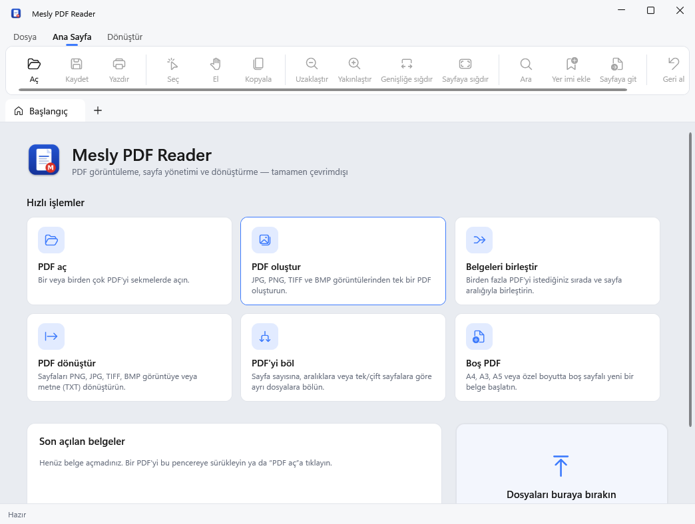
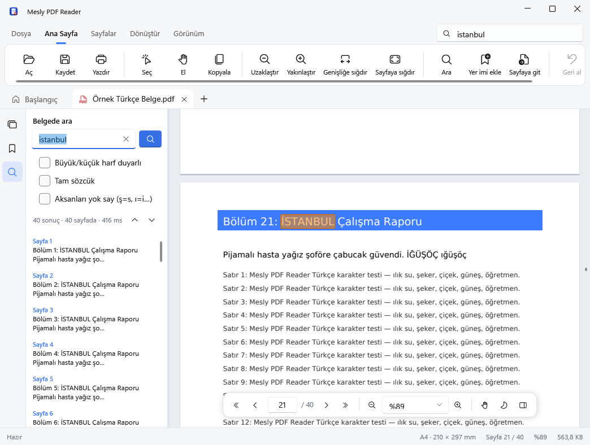
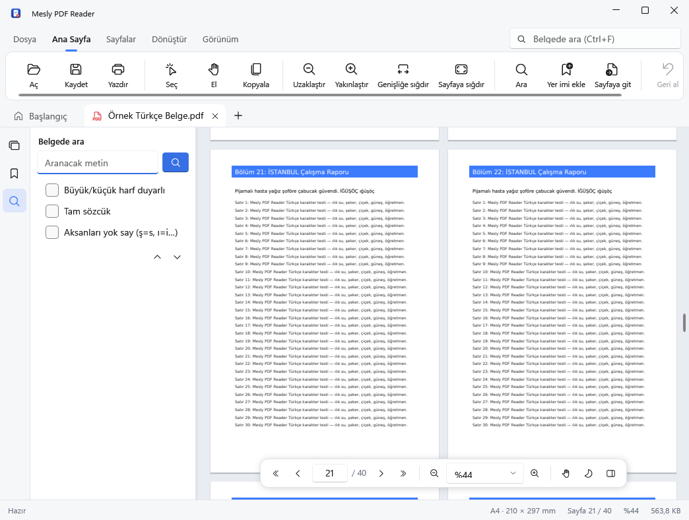
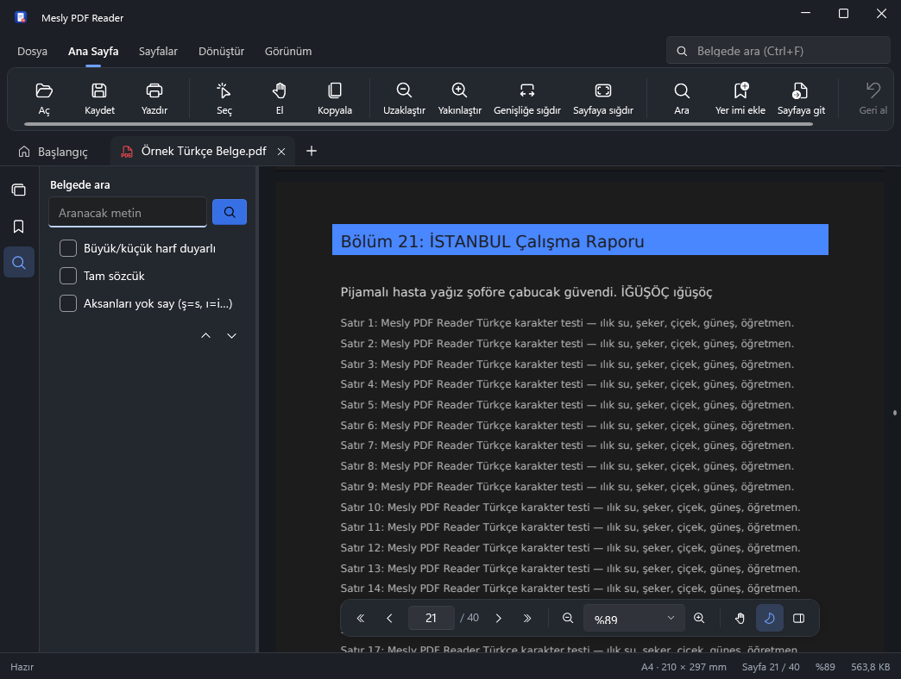

# Mesly PDF Reader (.NET 10 / WPF)

Windows 10 / 11 için profesyonel PDF görüntüleme, sayfa yönetimi ve dönüştürme uygulaması. C#, .NET 10, WPF ve MVVM ile yazılmıştır; tamamen çevrimdışı çalışır.

* Mimari ve kütüphane seçimleri: [`docs/MIMARI.md`](docs/MIMARI.md)
* Özellik kontrol listesi (ne hazır, ne planlı): [`docs/KONTROL_LISTESI.md`](docs/KONTROL_LISTESI.md)
* Test raporu: [`docs/TEST_RAPORU.md`](docs/TEST_RAPORU.md)
* Kurulum ve kullanım: [`docs/KURULUM_VE_KULLANIM.md`](docs/KURULUM_VE_KULLANIM.md)
* Sürüm notları: [`docs/SURUM_NOTLARI.md`](docs/SURUM_NOTLARI.md)
* Lisanslar: [`THIRD_PARTY_NOTICES.md`](THIRD_PARTY_NOTICES.md)

| | |
|---|---|
|  |  |
|  |  |

Ekran görüntüleri Windows Server 2025 üzerinde, kurulum paketinden kurulan uygulamanın öz testi sırasında otomatik alınmıştır.

## Klasör yapısı

```
dotnet/
├─ MeslyPdfReader.sln               Visual Studio 2022 (17.12+) / 2026 çözümü
├─ Directory.Build.props            ortak sürüm ve derleme ayarları
├─ Directory.Packages.props         merkezi NuGet sürüm yönetimi
├─ src/
│  ├─ MeslyPdfReader.Core/          modeller, sayfa aralığı, Türkçe arama, geometri (net10.0)
│  ├─ MeslyPdfReader.Pdf/           PDFium motoru: P/Invoke, PdfEngine, PdfDocument, araçlar (net10.0)
│  ├─ MeslyPdfReader.Data/          SQLite: ayarlar, son dosyalar, belge durumu, görev geçmişi (net10.0)
│  └─ MeslyPdfReader.App/           WPF arayüzü: görünümler, ViewModel'ler, PdfViewer denetimi, diyaloglar
├─ tests/MeslyPdfReader.Tests/      xUnit testleri + fikstürler
├─ installer/MeslyPdfReader.iss     Inno Setup 6 kurulum betiği
└─ docs/
```

## Derleme

Gereksinim: .NET 10 SDK (Windows'ta Visual Studio 2022 17.12+ veya 2026, ya da yalnız SDK).

```powershell
cd dotnet
dotnet test tests/MeslyPdfReader.Tests                      # birim testleri
dotnet run --project src/MeslyPdfReader.App                 # geliştirme
dotnet publish src/MeslyPdfReader.App -c Release -r win-x64 --self-contained -o ..\publish
..\publish\MeslyPdfReader.exe --selftest C:\temp\mesly-ozt  # gerçek pencerede uçtan uca öz test
iscc /DAppVersion=0.2.0 /DPublishDir=..\..\publish installer\MeslyPdfReader.iss   # kurulum dosyası → dotnet\artifacts
```

Linux/macOS'ta Core, Pdf, Data ve testler derlenip çalıştırılabilir; WPF projesi `EnableWindowsTargeting` sayesinde derlenir ama çalıştırılamaz.

## Otomatik derleme

`.github/workflows/dotnet-windows.yml` her `dotnet-wpf` push'unda:

1. Windows'ta birim testlerini çalıştırır,
2. self-contained `MeslyPdfReader.exe` yayınlar,
3. yayınlanan exe ile gerçek pencerede öz testi çalıştırır ve ekran görüntülerini artefakt olarak saklar,
4. `MeslyPdfReader-Setup-x.y.z.exe` ve taşınabilir zip üretir,
5. kurulumu Windows Server 2022 (Windows 10 çekirdeği) ve 2025 (Windows 11 çekirdeği) üzerinde sessizce kurar; kayıt defteri entegrasyonunu, kısayolları, kurulu uygulamada öz testi ve kaldırmayı doğrular,
6. `mpr-v*` etiketiyle GitHub Release oluşturur.
